# Análise Crítica e Arquitetura — Biblioteca Simples (Referência Única em 3 Estruturas)

> **Princípio Diretor (Referência Única Autônoma):** Este projeto opera como **fonte e referência única de conhecimento**, sem depender do Obsidian nem de nenhum vault externo. Toda a organização, busca e navegação acontecem diretamente sobre as **3 Estruturas Simples** (`1. O Bibliotecário`, `2. A Biblioteca e as Capas`, `3. O Livro Aberto`), operadas pela Interface Visual própria e pelo motor local `bibliotecario.py`.

---

## 1. Análise Crítica Direta: Por que as 3 Estruturas Superam o Projeto 1

O **Projeto 1 (`Better Obsydian` — 4 camadas)** resolveu problemas reais de *offload* e *sharding*, mas introduziu complexidade operacional alta para o uso diário: máquina de estados de *shards* com histerese (`<3`, `<=120`, `>120`, `<40`), fila de pré-empacotamento passivo (`00_inbox/`), envelhecimento de 14 dias, e múltiplos contratos cruzados (`KNW-YYYY-MM-DD-NN` <-> `ART-NNNN` <-> `MANIFESTO.yaml` <-> `hashes.json`).

A proposta do Lucas para o **Projeto 2 (Biblioteca Simples)** reduz toda a arquitetura cognitiva a **3 estruturas naturais** que qualquer humano ou LLM entende sem manual:

| Dimensão | Projeto 1 (4 Camadas + Shards) | Projeto 2: Biblioteca Simples (3 Estruturas) | Ganho Real |
|---|---|---|---|
| **Modelo Mental** | `Inbox -> Conhecimento -> Projetos -> Índices Sharded + Pasta Irmã` | **1. Bibliotecário -> 2. Biblioteca & Capas -> 3. Livro Aberto** | Zero fricção cognitiva; metáfora universal de biblioteca |
| **Caminho de Leitura (LLM)** | Hub -> Shard Pai -> Sub-shard -> Nota KNW -> Manifesto -> Artefato | **3 saltos fixos:** `INDICE_MASTER.md` -> `categorias/<cat>.md` -> `capas/<id>.md` | Máximo de **< 1.500 tokens** gastos antes de decidir abrir o arquivo pesado |
| **Onde fica o Conhecimento Rápido** | Espalhado entre notas atômicas `KNW-*` e índices | Concentrado na **Capa do Livro (`capas/<id>.md`)** com resumo executivo e mapa de coordenadas | 85% das dúvidas são respondidas só lendo a Capa (~220 tokens) |
| **Onde fica o Peso Bruto** | `../BetterObsydian_Artefatos/ART-NNNN/` exigindo manifesto separado | Dentro de **`livros_abertos/<id>/`** (código, repo GitHub, PDF, vídeo, fotos) | Tudo que pertence ao tema mora na mesma caixa física (`LIV-NNN`) |
| **Economia Média de Contexto** | ~75% a 85% | **94% a 98,8%** (lê ~220 tokens na Capa em vez de ~18.500 tokens do Livro Aberto) | Janela de contexto limpa para raciocínio e código |

### A Matemática dos 3 Saltos Curtos (< 1.500 Tokens)

```mermaid
flowchart LR
    P["Pedido do Usuário / Agente"] --> B["1. O Bibliotecário"]
    B -->|"Salto 1 (~180 tokens)"| M["INDICE_MASTER.md (~40 linhas)"]
    M -->|"Salto 2 (~240 tokens)"| C["categorias/<cat>.md (~60 linhas)"]
    C -->|"Salto 3 (~220 tokens)"| K["capas/LIV-NNN.md (~50 linhas)"]
    K -->|"Coordenada Exata (ex: motor.js:12-45)"| L["3. O Livro Aberto (livros_abertos/LIV-NNN/)"]
```



1. **Salto 1 (`INDICE_MASTER.md`):** ~35–45 linhas (~180 tokens). Lista apenas as estantes (categorias), contagem de livros e mapa rápido de IDs.
2. **Salto 2 (`categorias/<cat>.md`):** ~45–60 linhas (~240 tokens). Lista os livros daquela categoria com gatilhos de quando usar cada um.
3. **Salto 3 (`capas/LIV-NNN_*.md`):** ~45–55 linhas (~220 tokens). Entrega a **Ficha de Conhecimento Destilado** (regras, armadilhas, decisão rápida) + o **Sumário de Coordenadas**.
4. **Abertura Cirúrgica (`livros_abertos/LIV-NNN/`):** Em vez de despejar 18.500 tokens de um repositório ou PDF inteiro no prompt, o agente lê apenas as 35 linhas apontadas pela coordenada da Capa.

---

## 2. Onde a Proposta Original Falharia Sozinha (e as 4 Melhorias Críticas)

Uma arquitetura de `Índice Master -> Sub-índices -> Capas -> Livro Aberto` tem 4 armadilhas clássicas se implementada de forma ingênua. Abaixo estão as **4 melhorias arquiteturais** implementadas neste projeto para blindá-la:

### Melhoria (a): O Bibliotecário de Duas Velocidades (Motor `< 5 ms` + Agente em 3 Saltos)
- **O Risco:** Se "O Bibliotecário" for apenas um agente LLM lendo arquivos Markdown a cada busca simples da interface, cada clique ou filtro custará segundos de latência e tokens de API. Por outro lado, se for apenas um script burro de busca por palavra, não saberá navegar contextualmente quando um agente autônomo precisar estudar um tema.
- **A Solução Implementada:**
  1. **Velocidade 1 — Motor Determinístico (`bibliotecario.py` + `catalogo.json`):** Busca léxica ponderada (`título > gatilhos > coordenadas > resumo`) que responde em **`< 5 ms` com 0 tokens**, alimentando tanto o terminal (`python bibliotecario.py buscar "<termo>"`) quanto a interface visual (`ui/`).
  2. **Velocidade 2 — Contrato de Agente LLM (`BIBLIOTECARIO_AGENTE.md`):** Protocolo estrito de 3 leituras (`Master -> Categoria -> Capa`) que proíbe o LLM de usar `grep` cego em `livros_abertos/` e exige leitura cirúrgica por coordenada.

### Melhoria (b): Sumário de Coordenadas na Capa (Zero Abertura às Cegas)
- **O Risco:** A Capa diz *"O código e o vídeo estão no Livro Aberto LIV-001"*. O humano ou agente abre a pasta `livros_abertos/LIV-001/` e encontra um repositório de 40 arquivos, um PDF de 120 páginas ou um vídeo de 45 minutos — voltando à estaca zero para achar onde está a resposta.
- **A Solução Implementada:** Toda Capa (`capas/LIV-NNN_*.md`) possui uma tabela obrigatória chamada **Sumário de Coordenadas do Livro Aberto**. Cada coordenada aponta o alvo exato:
  - **Código / GitHub:** `motor_gsap.js:14-58` (função ou bloco exato por linhas);
  - **Vídeo:** `02:15-03:40` (intervalo de timestamp exato da técnica);
  - **PDF / Livro:** `Cap. 3, p. 42-48` (capítulo e páginas exatas);
  - **Fotos / Referências:** `prancha_02_hud.svg#camada-bloom` (item visual específico).

### Melhoria (c): Catalogação e Sincronização de 1 Comando (`bibliotecario.py sincronizar` / `catalogar`)
- **O Risco:** Manter 3 níveis de Markdown (`INDICE_MASTER.md`, `categorias/*.md` e `capas/*.md`) mais o `catalogo.json` sincronizados à mão é garantia de deriva: na terceira semana o usuário cria uma Capa e esquece de atualizar o Sub-índice ou o Master.
- **A Solução Implementada:** As **Capas (`capas/LIV-NNN_*.md`) + pastas `livros_abertos/LIV-NNN/` são a única fonte da verdade**. Rodar `python bibliotecario.py sincronizar` (ou `python bibliotecario.py catalogar --id LIV-007 ...`) varre as Capas e os Livros Abertos, calcula estimativas reais de tokens/tamanhos e regenera `categorias/*.md`, `INDICE_MASTER.md` e `catalogo.json` em milissegundos.

### Melhoria (d): Isolamento Físico entre Capas Leves e Livros Abertos Pesados
- **O Risco:** Misturar resumos leves com PDFs, vídeos MP4, imagens e árvores de código na mesma pasta faz o controle de versão (Git), o backup ou o indexador local travarem varrendo binários e `node_modules`.
- **A Solução Implementada:**
  - `INDICE_MASTER.md`, `categorias/` e `capas/` são **100% Markdown puro, leve e legível em qualquer lugar** (< 4 KB por arquivo).
  - `livros_abertos/<id>/` isola fisicamente os pacotes densos (repositórios, códigos-fonte, vídeos, PDFs, galerias), mantendo o motor de busca e a interface sempre instantâneos.

---

## 3. Topologia Canônica da Referência Única (`02_BIBLIOTECA_SIMPLES/`)

```text
02_BIBLIOTECA_SIMPLES/
├── ARQUITETURA_CRITICA.md                        # Arquitetura canônica da Referência Única
├── PLANO_UI_FRIENDLY_E_REFERENCIA_UNICA.md       # Planejamento da evolução visual para usuários leigos + autonomia total
├── BIBLIOTECARIO_AGENTE.md                       # Contrato para agentes IA (protocolo de 3 saltos)
├── bibliotecario.py                              # Motor local (< 5 ms): sincronizar, buscar, catalogar, testar
├── catalogo.json                                 # Índice compilado compartilhado com a UI e o CLI
├── INDICE_MASTER.md                              # Salto 1: Mapa geral das Categorias e Estantes (~40 linhas)
├── categorias/                                   # Salto 2: Sub-índices temáticos (~50 linhas cada)
│   ├── engenharia-e-codigo.md
│   ├── midia-e-motion.md
│   └── referencias-e-livros.md
├── capas/                                        # Salto 3: Fichas destiladas + Índice Rápido do Material (Coordenadas)
│   ├── LIV-001_motor-gsap-deterministico.md
│   ├── LIV-002_repo-orquestrador-agentes.md
│   ├── LIV-003_video-edicao-9x16-lufs.md
│   ├── LIV-004_galeria-referencias-visuais.md
│   ├── LIV-005_livro-arquitetura-memoria.md
│   └── LIV-006_pacote-benchmark-busca.md
├── livros_abertos/                               # Estrutura 3: O Livro Aberto (pacotes completos por ID)
│   ├── LIV-001/                                  # Código Fonte real (motor GSAP renderAt + validador PSNR)
│   ├── LIV-002/                                  # Espelho de Repositório GitHub (árvore + SDK runner)
│   ├── LIV-003/                                  # Pacote de Vídeo (roteiro de timestamps + pipeline FFmpeg)
│   ├── LIV-004/                                  # Galeria de Fotos/Refs (pranchas SVG + tokens visuais)
│   ├── LIV-005/                                  # Livro/PDF Técnico estruturado por capítulos e páginas
│   └── LIV-006/                                  # Pacote Misto (dataset golden + script + relatório)
└── ui/                                           # Interface Visual Própria (Substitui editores externos)
    ├── index.html
    ├── style.css
    └── app.js
```

---

## 4. Autonomia Total (Sem Obsidian e Sem Vault Externo)

Com a desativação do Obsidian e a eliminação de qualquer dependência de vault externo:
1. **Referência Única:** Todo conhecimento aprendido (estudos, livros, códigos, repositórios, vídeos, fotos e decisões) entra diretamente nesta estrutura como **Capa + Livro Aberto**.
2. **Interface Própria Soberana:** A pasta `ui/` deixa de ser um acessório de um vault Obsidian e passa a ser a **interface oficial de navegação, leitura e catalogação**, operando sobre arquivos abertos (`.md` + pastas em `livros_abertos/`) que nunca prendem os dados do usuário num formato proprietário.
