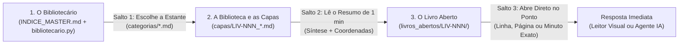

# BetterVault — Biblioteca Inteligente em 3 Estruturas (Para Humanos e Agentes de IA)

> **Guarde qualquer conhecimento — códigos, repositórios GitHub, livros/PDFs, vídeos com capítulos em minutos e galerias visuais — e encontre a resposta exata em segundos, sem se perder em centenas de arquivos.**

O **BetterVault** substitui pastas caóticas e cofres pesados por uma arquitetura enxuta e transparente de **3 Estruturas Simples**, projetada simultaneamente para **pessoas leigas** (com interface visual acolhedora em papel quente) e **Agentes de IA** (com economia de ~98% de tokens na janela de contexto e busca determinística em `< 5 ms`, zero dependências externas).

---

## As 3 Estruturas Simples



1. **O Bibliotecário (`bibliotecario.py` + `INDICE_MASTER.md` + `catalogo.json`)**
   - É a recepção da biblioteca. Conhece todas as estantes, mantém o catálogo sincronizado automaticamente, responde buscas em português em `< 5 ms` e serve a interface web local.
2. **A Biblioteca e as Capas (`categorias/*.md` + `capas/LIV-NNN_*.md`)**
   - Cada material guardado ganha uma **Capa leve** (~200 a 500 tokens, leitura de **1 minuto**).
   - A Capa traz: **Para que serve** (em linguagem simples), **O que você encontra aqui** (resumo executivo em tópicos) e o índice **Ir Direto ao Ponto** (Sumário de Coordenadas com linhas, páginas ou minutos exatos).
3. **O Livro Aberto (`livros_abertos/LIV-NNN/`)**
   - É a pasta onde moram os arquivos completos e pesados daquele item: códigos-fonte, scripts, capítulos de livros/PDFs, mapas de timestamps de vídeo ou pranchas visuais SVG/PNG.
   - Nem o humano nem a IA precisam abrir todos os Livros Abertos de uma vez: você só abre o Livro Aberto quando a Capa indicar o ponto exato que você quer ver.

---

## Como Iniciar em 1 Clique (ou 1 Comando)

### Pré-requisito
- **Python 3.9+** instalado (usa **100% biblioteca padrão do Python** — não precisa instalar `pip` nem pacotes externos).

### Opção 1 — Duplo Clique (Windows)
Dê um duplo clique no arquivo [`INICIAR_BIBLIOTECA.bat`](file:///d:/ANTIGRAVITY%20REPO/01%20Projetos/01%20-%20Better%20Obsydian/INICIAR_BIBLIOTECA.bat) ou execute [`iniciar.ps1`](file:///d:/ANTIGRAVITY%20REPO/01%20Projetos/01%20-%20Better%20Obsydian/iniciar.ps1) no PowerShell.

### Opção 2 — Terminal
```bash
python bibliotecario.py servir --porta 4325
```
Em seguida, abra **[http://127.0.0.1:4325](http://127.0.0.1:4325)** no navegador.

---

## Como Usar a Interface Visual (Humanos) vs. Modo Técnico (IA)

### Para Humanos (Modo Amigável Padrão)
1. **Guardar Novo Material (`+ Guardar na Biblioteca`):**
   - Clique no botão **`+ Guardar na Biblioteca`** no topo direito (ou no cartão de boas-vindas da instalação limpa).
   - Escolha uma estante existente (*Engenharia & Código*, *Mídia, Vídeo & Motion*, *Referências, Livros & Estudos*) ou selecione **`+ Criar nova estante personalizada...`** para criar suas próprias categorias.
   - Se quiser testar em 1 segundo, clique em **`✨ Preencher Exemplo`** e depois em **`Guardar na Biblioteca`**.
2. **Explorar as Capas (Coluna Central):**
   - Cada cartão mostra a etiqueta de formato (*Código*, *GitHub*, *Vídeo*, *Fotos*, *Livro / PDF*), o tempo de leitura da capa (`⏱ Resumo de 1 min`) comparado ao tamanho do material completo e a explicação clara de **para que serve**.
3. **Ler a Contracapa e Pular Direto ao Ponto (Coluna Direita):**
   - Ao clicar em um cartão, a coluna direita mostra o resumo rápido e os botões **Ir Direto ao Ponto** (ex.: `Capítulo 2 · Págs. 19 a 34`, `Vídeo · Minuto 01:12 a 02:05`, `Código · Linhas 10 a 32`).
   - Clicar em qualquer ponto abre o **Livro Aberto** já no arquivo correspondente e destaca em amarelo exatamente as linhas, páginas ou minutos indicados!

### Modo Técnico (Botão `Modo Técnico (IA)` no Topo)
- Ative o botão **`Modo Técnico (IA)`** na barra superior para exibir métricas de engenharia de contexto (tokens do Índice Master, tokens médios por Capa, economia percentual de contexto, IDs `LIV-NNN`, caminhos brutos `capas/` e `livros_abertos/`).

---

## Comandos de Linha de Comando (`bibliotecario.py`)

```bash
# 1. Sincronizar estantes (categorias/*.md), INDICE_MASTER.md e catalogo.json
python bibliotecario.py sincronizar

# 2. Buscar em português em < 5 ms (retorna a Capa #1 + coordenada exata)
python bibliotecario.py buscar "como configurar animacao ou video"

# 3. Catalogar um novo material em 1 comando (calcula o próximo ID LIV-NNN automaticamente)
python bibliotecario.py catalogar \
  --titulo "Guia Prático de APIs REST em Python" \
  --subtitulo "Padrões de rotas, validação e testes" \
  --explicacao-leiga "Ensina a criar e testar uma API web rápida usando apenas Python puro." \
  --categoria "engenharia-e-codigo" \
  --tipo "codigo-fonte" \
  --tempo-capa "1 min" \
  --tempo-completo "Projeto com 2 arquivos" \
  --tags "python,api,http,rest" \
  --gatilhos "criar servidor http em python; testar rotas json" \
  --resumo $'Servidor HTTP sem dependências externas.\nValidação limpa de payloads JSON.' \
  --coordenada "Servidor HTTP|servidor.py:1-45|codigo|Classe principal de rotas GET e POST" \
  --nome-arquivo "servidor.py" \
  --conteudo-arquivo "# Código do servidor HTTP..."

# 4. Rodar suíte de autoteste fim-a-fim (100% verde mesmo em instalação limpa)
python bibliotecario.py testar
```

---

## Como Instalar e Usar a Skill para Agentes de IA (`SKILL.md`)

O BetterVault já vem com uma **Skill oficial completa** para que qualquer Agente de IA (Claude Code, Antigravity, Cursor, Codex, Gemini CLI) saiba consultar e catalogar conhecimentos autonomamente seguindo a regra das 3 estruturas:

- **Na raiz do repositório:** [`SKILL.md`](file:///d:/ANTIGRAVITY%20REPO/01%20Projetos/01%20-%20Better%20Obsydian/SKILL.md)
- **No pacote de skills:** [`skills/better-vault/SKILL.md`](file:///d:/ANTIGRAVITY%20REPO/01%20Projetos/01%20-%20Better%20Obsydian/skills/better-vault/SKILL.md)

Para instalar globalmente no seu agente, basta copiar a pasta `skills/better-vault/` para o diretório de skills do seu assistente (ex.: `~/.gemini/config/skills/better-vault/` ou `.claude/skills/better-vault/`) ou pedir ao agente:
> *"Leia o arquivo `SKILL.md` na raiz do projeto BetterVault e siga o protocolo das 3 estruturas para consultar ou guardar materiais nesta biblioteca."*

---

## Estrutura de Pastas do Repositório

```text
BetterVault/
├── bibliotecario.py            # Motor CLI + Buscador PT-BR (< 5 ms) + Servidor HTTP/API
├── INDICE_MASTER.md            # Porta de entrada única (Salto 1 -> Estantes e Mapa de Capas)
├── catalogo.json               # Catálogo compilado para a UI e integrações (0 livros na instalação limpa)
├── SKILL.md                    # Manual operacional completo para Agentes de IA
├── README.md                   # Guia humano e documentação geral do projeto
├── INICIAR_BIBLIOTECA.bat      # Inicializador de 1 clique para Windows (CMD)
├── iniciar.ps1                 # Inicializador rápido para PowerShell
├── categorias/                 # Sub-índices automáticos por estante (gerados pelo Bibliotecário)
│   ├── engenharia-e-codigo.md
│   ├── midia-e-motion.md
│   └── referencias-e-livros.md
├── capas/                      # Capas Markdown leves (~200-500 tokens cada, LIV-NNN_<slug>.md)
│   └── .gitkeep
├── livros_abertos/             # Pastas com os materiais completos (livros_abertos/LIV-NNN/*)
│   └── .gitkeep
├── ui/                         # Interface Web em 3 Colunas + Leitor Cirúrgico + Modal Guardar
│   ├── index.html
│   ├── style.css
│   └── app.js
└── skills/
    └── better-vault/
        └── SKILL.md            # Cópia empacotada da Skill para instalação em agentes
```
